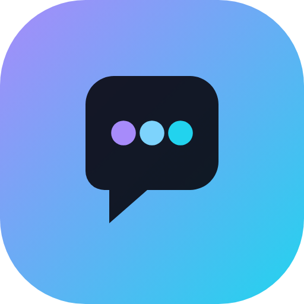
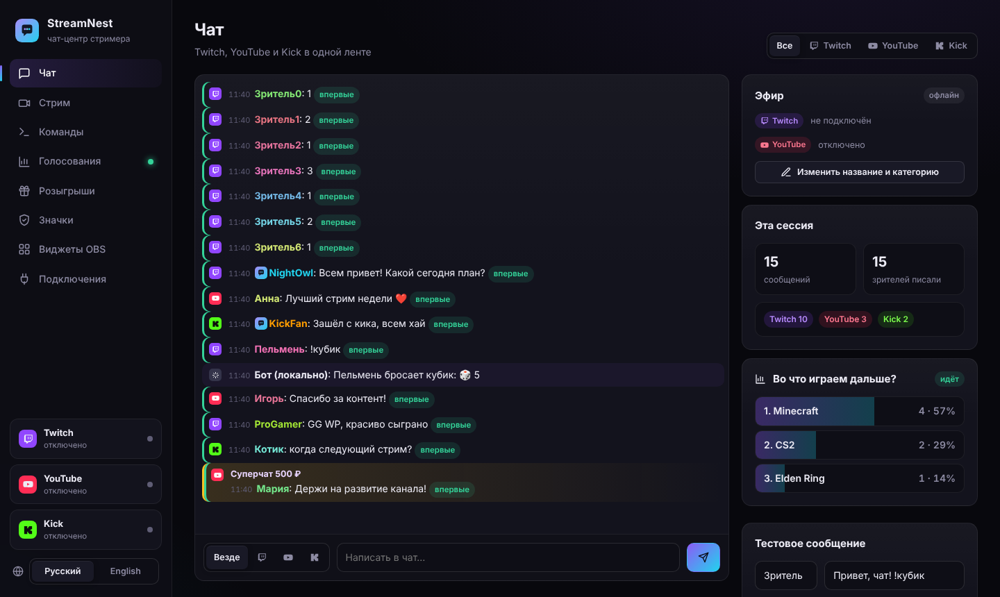
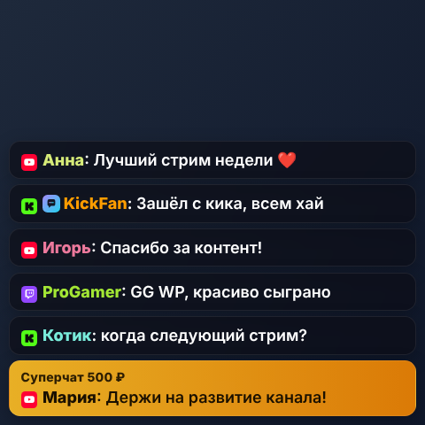
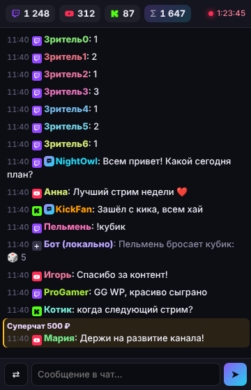

<p align="center">
  
</p>

<h1 align="center">StreamNest</h1>

<p align="center">
  Чат-центр для стримеров: Twitch, YouTube и Kick в одной ленте, виджеты для OBS, голосования, розыгрыши и чат-бот.<br>
  <a href="#english">English below</a>
</p>

<p align="center">
  
</p>

## Возможности

- **Единый чат** Twitch, YouTube и Kick. Для чтения достаточно ника канала, вход в аккаунт не нужен.
- **Эмоуты** 7TV, BetterTTV, FrankerFaceZ, а также собственные эмоуты Kick и YouTube.
- **Виджеты OBS**: чат (три стиля, размер, анимации), голосование и розыгрыш с рулеткой.
- **Док-панель OBS**: компактный чат, счётчик зрителей со всех платформ, время эфира, отправка сообщений.
- **Свои значки** рядом с ником: выдаются вручную, по роли или за количество сообщений.
- **Голосования**: зрители пишут номер варианта в чат, результаты обновляются в реальном времени.
- **Розыгрыши**: участие по ключевому слову, повышенный шанс для сабов, рулетка, победитель скрыт до остановки.
- **Команды бота** с переменными (`{user}`, `{random:1-6}`, `{uptime}` и другие), кулдаунами и правами доступа.
- **Модерация** Twitch и Kick: настраиваемые кнопки мута, бана и удаления сообщения.
- **Название и категория** стрима на Twitch, YouTube и Kick, плюс сохранённые пресеты.
- **Русский и английский** интерфейс.
- **Работа в трее**: чат и виджеты остаются активными, когда окно свёрнуто.

<p align="center">
  
  
</p>

## Установка

### Готовая программа (Windows)

1. Установите [Node.js 22 LTS](https://nodejs.org) или новее (нужен только для сборки).
2. Запустите **`build-exe.bat`**.
3. Программа появится в **`dist\StreamNest.exe`**. Это один файл, установка не нужна.

Установщик с ярлыком на рабочем столе собирается командой `npm run build:installer`.

### Запуск без сборки

```bash
npm start
```

Панель откроется в браузере по адресу http://localhost:3777. На Windows можно просто запустить `start.bat`.

Для работы сервера внешние зависимости не нужны, достаточно Node.js 22+.

## Подключение платформ

Во вкладке «Подключения» введите ник канала, и чат начнёт читаться:

| Платформа | Что ввести |
|---|---|
| Twitch | ник или ссылку `twitch.tv/ник` |
| YouTube | `@ник`, ссылку на канал или на трансляцию |
| Kick | ник или ссылку `kick.com/ник` |

Вход в аккаунт необязателен. Он нужен, чтобы бот писал в чат, для кнопок модерации и для смены названия и категории стрима. Пошаговые инструкции по созданию приложений Twitch, Google и Kick есть прямо в программе.

## Виджеты OBS

Добавьте источник «Браузер» и вставьте ссылку:

| Виджет | Адрес |
|---|---|
| Чат | `http://localhost:3777/overlay/chat.html` |
| Голосование | `http://localhost:3777/overlay/poll.html` |
| Розыгрыш | `http://localhost:3777/overlay/giveaway.html` |
| Док-панель | `http://localhost:3777/dock.html` (Док-панели → Пользовательские док-панели браузера) |

Параметры адреса виджета чата: `?theme=minimal`, `?size=24`, `?history=0`, `?w=400&h=300&anchor=right`.

## Переменные команд

`{user}` `{target}` `{args}` `{1}` `{random:1-100}` `{pick:да|нет}` `{count}` `{messages}` `{uptime}` `{game}` `{title}` `{time}`

## Безопасность и данные

- Сервер слушает только `127.0.0.1` и недоступен из сети.
- Запросы с других сайтов (CSRF) и подмена адреса (DNS rebinding) блокируются.
- Токены и настройки хранятся локально: в папке `data/` или, в собранной программе, в `%APPDATA%\StreamNest\data`. Не публикуйте эту папку.
- Чтение чата YouTube и Kick без входа использует публичные интерфейсы сайтов. Они могут измениться без предупреждения.

## Структура проекта

```
server/      сервер: чат платформ, API, бот, опросы, розыгрыши, значки
public/      панель управления, док-панель и виджеты OBS
electron/    оболочка программы для Windows
build/       иконки
```

---

<h2 id="english">English</h2>

StreamNest is a chat hub for streamers. It shows Twitch, YouTube and Kick chat in one feed and includes OBS widgets, polls, giveaways and a chat bot.

**Features:** unified chat (reading needs only a channel name, no sign-in), 7TV/BTTV/FFZ emotes, OBS chat/poll/giveaway widgets, an OBS dock with a combined viewer count, custom badges, chat polls, giveaways with a spinning wheel, bot commands with variables, Twitch and Kick moderation buttons, stream title/category editing, Russian and English UI, system tray mode.

**Install (Windows):** install [Node.js 22+](https://nodejs.org), run `build-exe.bat`, and the app is built to `dist\StreamNest.exe`. To run without building, use `npm start` and open http://localhost:3777.

**Connect:** on the Connections tab, enter a Twitch name, a YouTube @handle or link, or a Kick name. Signing in is optional and only needed for bot messages, moderation and stream title changes.

**OBS:** add Browser sources with `/overlay/chat.html`, `/overlay/poll.html` and `/overlay/giveaway.html`. Add `/dock.html` as a Custom Browser Dock.

**Data:** everything is stored locally in `data/` (or `%APPDATA%\StreamNest\data` for the built app). The server only listens on `127.0.0.1`.

## License

[MIT](LICENSE) © 2026 Altov
